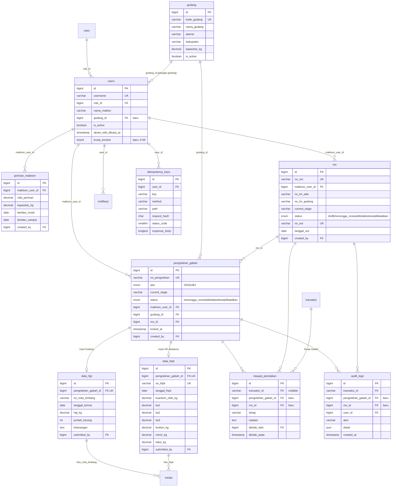

# Modul Pengolahan Gabah — Arsitektur Backend & ERD

Dokumen acuan backlog Teknis #17. Kontrak endpoint ada di
[pengolahan-gabah-kontrak-api.md](pengolahan-gabah-kontrak-api.md). Alur dan aturan bisnis
mengikuti laporan skripsi (Bab 3: Gambar 6–15, Tabel 5, Tabel 11, KNF-4).

## 1. Arsitektur berlapis

Backend Laravel 11 (REST API murni) dipakai bersama oleh website React.js dan aplikasi mobile
React Native. Setiap request melewati lapisan berikut, dan setiap lapisan hanya memanggil
lapisan di bawahnya:

```
Client (React SPA / React Native)
   │  HTTPS + JSON + Bearer token, header Idempotency-Key
   ▼
1. Routing            routes/api.php                     peta URL → controller
2. Middleware         auth:sanctum, user.aktif,           401: token tidak sah / akun nonaktif
                      role:… (RoleMiddleware),            403: role tidak berwenang (RBAC0)
                      throttle, idempotency               429: batas laju; cegah proses ganda
3. Validasi input     app/Http/Requests/PengolahanGabah/* 422: isi request tidak valid
4. Controller         app/Http/Controllers/Api/*          tipis: terima request, panggil
                                                          service, bungkus Resource
5. Service (domain)   app/Services/PengolahanGabah/*      workflow: status asal-tujuan + role
                                                          (422 bila di luar alur), gabung MO,
                                                          jaminan Makloon, kuota koreksi,
                                                          transaksi DB, audit & notifikasi
6. Model (data)       app/Models/*                        Eloquent, relasi, casts
7. Resource (output)  app/Http/Resources/*                bentuk JSON, penyaringan kolom per
                                                          role, field turunan (rendemen)
   ▼
MySQL 8 (InnoDB) + Storage Disk lokal (foto, via spatie/laravel-medialibrary)
```

Aturan antar-lapisan:

- RBAC menentukan **siapa** (middleware, 403); workflow menentukan **kapan** (service, 422).
- Controller **tidak** berisi aturan bisnis; web dan mobile memakai service yang sama.
- Perpindahan tahap hanya terjadi di `PengolahanStageService`, sehingga dapat diuji unit tanpa
  HTTP (KNF-3) dan validasi alur GDG/UBJ tidak tersebar.
- Setiap operasi tulis multi-tabel dibungkus `DB::transaction()`.
- Batasan yang bisa dijamin database ditegakkan di DB, bukan hanya di validasi aplikasi:
  unik `no_lhpk`, unik `no_mo`, unik `no_out`, satu pengolahan satu MO (KNF-4, termasuk dua
  request bersamaan).
- Layanan yang sudah ada dipakai ulang: `AuditLogService`, `NotifikasiService`,
  `FotoUploadService`, `FotoAccessService`, `RoleMiddleware`, `PastikanUserAktif`, model
  `RiwayatPenolakan`.

## 2. Struktur proyek (file modul Pengolahan Gabah)

Hanya backend. `frontend/` dan `mobile/` tidak diubah oleh modul ini.

```
backend/
├─ app/
│  ├─ Http/
│  │  ├─ Controllers/Api/
│  │  │  ├─ PengolahanGabahController.php   # list, detail, input tahap, terima/tolak, batal, koreksi
│  │  │  ├─ MoController.php                # MO: buat, anggota, kirim, batal, terima (OUT), tolak
│  │  │  ├─ GudangController.php            # CRUD master gudang (admin)
│  │  │  ├─ JaminanMakloonController.php    # jaminan & kapasitas Makloon (operasi)
│  │  │  └─ PengolahanLaporanController.php # rekap, neraca, monitoring (admin)
│  │  ├─ Middleware/
│  │  │  └─ IdempotencyKey.php
│  │  ├─ Requests/PengolahanGabah/          # FormRequest per aksi tulis
│  │  └─ Resources/
│  │     ├─ PengolahanGabahResource.php
│  │     └─ MoResource.php
│  ├─ Models/
│  │  ├─ PengolahanGabah.php  DataHgl.php  DataLhpk.php  Mo.php
│  │  ├─ Gudang.php  JaminanMakloon.php  IdempotencyKey.php
│  │  └─ RiwayatPenolakan.php  AuditLog.php          # sudah ada, ditambah relasi
│  └─ Services/PengolahanGabah/
│     ├─ PengolahanStageService.php  # urutan tahap GDG/UBJ + validasi transisi (sumber tunggal)
│     ├─ MoService.php               # gabung/lepas anggota, kirim, terbit OUT
│     ├─ JaminanMakloonService.php   # sisa kapasitas + pemeriksaan kiriman Makloon
│     └─ LaporanPengolahanService.php
├─ database/
│  ├─ migrations/
│  │  ├─ 2026_11_26_100000_create_master_pengolahan_gabah.php
│  │  ├─ 2026_11_26_100100_create_pengolahan_gabah_tables.php
│  │  └─ 2026_11_26_100200_create_idempotency_keys_table.php
│  └─ seeders/RoleSeeder.php        # + role operasi, gudang
├─ routes/api.php                   # grup /api/pengolahan-gabah, /api/mo, /api/gudang, …
└─ tests/
   ├─ Unit/PengolahanGabah/         # PengolahanStageService, AuditLogService, NotifikasiService
   └─ Feature/PengolahanGabah/      # integration test per role
```

Yang sudah dibuat di tahap ini: migration, RoleSeeder, dan dokumen ini. Kelas lain dibuat saat
backlog fungsionalnya dikerjakan.

## 3. Alur & state machine

Setiap transaksi melewati **Gudang dan UB Jastasma**. Yang berbeda hanya urutan dua tahap
awal, ditentukan oleh bagian yang lebih dulu menginput data (*conditional routing*):

| Alur | Tahap 1 (input & kirim) | Tahap 2 (tinjau, input, kirim) | Tahap 3 | Tahap 4 | Akhir |
|---|---|---|---|---|---|
| **GDG** | `gudang` — HGL + foto nota timbang | `ub_jastasma` — LHPK + foto | `operasi` — tinjau, gabung MO | `pengadaan` — tinjau MO, tanggal OUT | `selesai` |
| **UBJ** | `ub_jastasma` — LHPK + foto | `gudang` — HGL + foto nota timbang | `operasi` — tinjau, gabung MO | `pengadaan` — tinjau MO, tanggal OUT | `selesai` |

Transisi pengolahan (`pengolahan_gabah`) yang sah. Semua transisi lain ditolak **422**:

| Dari `current_stage` / `status` | Aksi | Role | Ke `current_stage` / `status` |
|---|---|---|---|
| — | input tahap 1 & kirim | gudang (GDG) / ub_jastasma (UBJ) | tahap 2 / `menunggu_review` |
| tahap 2 / `menunggu_review` | terima + input data sendiri & kirim | role tahap 2 | `operasi` / `menunggu_review` |
| tahap 2 / `menunggu_review` | tolak (alasan) | role tahap 2 | tahap 1 / `ditolak` |
| tahap 1 / `ditolak` | perbaiki & kirim ulang | role tahap 1 | tahap 2 / `menunggu_review` |
| `operasi` / `menunggu_review` | tolak (alasan) | operasi | tahap 2 / `ditolak` (GDG → ub_jastasma, UBJ → gudang) |
| tahap 2 / `ditolak` | perbaiki & kirim ulang | role tahap 2 | `operasi` / `menunggu_review` |
| `operasi` / `menunggu_review` | masukkan ke MO (Makloon sama) | operasi | tetap; `mo_id` terisi |
| `operasi`, masih di MO `draft` | lepaskan dari MO | operasi | tetap; `mo_id` kosong |
| tahap 1 atau 2, belum masuk MO | batalkan | pembuat / admin | — / `dibatalkan` |

Transisi MO (`mo`):

| Dari `status` | Aksi | Role | Ke |
|---|---|---|---|
| — | buat MO | operasi | `draft` (`current_stage = operasi`) |
| `draft` / `ditolak` | tambah/lepas anggota, isi TM ADA & TM Gudang | operasi | tetap |
| `draft` / `ditolak` | kirim (min. 1 anggota, TM lengkap) | operasi | `menunggu_review`, `current_stage = pengadaan`; anggota ikut ke `pengadaan` |
| `draft` | batalkan | operasi | `dibatalkan`; anggota dilepas |
| `menunggu_review` | tolak (alasan) | pengadaan | `ditolak`, `current_stage = operasi`; anggota kembali ke `operasi` |
| `menunggu_review` | terima + tanggal OUT | pengadaan | `selesai`, No OUT diterbitkan sistem; anggota `selesai` & `locked_at` diisi |

Efek samping setiap transisi sah (Gambar 8): simpan data → ubah status → notifikasi ke role
tahap tujuan → catat `audit_logs`. Penolakan juga menulis `riwayat_penolakan` (alasan,
pelaku, waktu).

**Koreksi data terkunci (KF-12, Gambar 13):** Admin memberi petugas jatah `users.kuota_koreksi`
(0–99). Setiap kali petugas menyimpan koreksi pada data miliknya yang sudah terkunci, jatah
berkurang satu; jatah 0 berarti terkunci kembali.

**Jaminan Makloon (KF-15, Gambar 9):** Operasi mengatur jaminan & kapasitas per Makloon.
Kiriman Makloon pada alur Serap Gabah diperiksa: jika kuantum kiriman melebihi sisa kapasitas
(kapasitas − stok gabah di Makloon yang belum diolah), kiriman ditolak 422.

## 4. ERD



Perubahan pada tabel lama: `users` (+`gudang_id`, +`kuota_koreksi`), `riwayat_penolakan`
(`transaksi_id` jadi nullable, +`pengolahan_gabah_id`, +`mo_id`), `audit_logs`
(+`pengolahan_gabah_id`, +`mo_id`), `nomor_urut_transaksi.skema` (+`GDG`, +`UBJ`). Tabel
`notifikasi` tidak berubah: id pengolahan/MO dikirim di kolom `data` JSON.

### Keputusan desain

- **PK bigint + `no_pengolahan` unik** (bukan PK varchar seperti `transaksi`): kolom
  `media.model_id` bertipe bigint, dan FK bigint lebih ringan.
- **Satu tabel data per bagian** (`data_hgl` milik Gudang, `data_lhpk` milik UB Jastasma), relasi
  1:1 — mengikuti pola `data_*` modul Serap Gabah; urutan pengisiannya ditentukan `alur`. Foto
  menempel ke baris ini.
- **MO ↔ pengolahan lewat `pengolahan_gabah.mo_id`**, tanpa tabel pivot: satu pengolahan
  secara struktural hanya bisa berada di satu MO (KNF-4).
- **`riwayat_penolakan` dipakai bersama** Serap Gabah dan Pengolahan Gabah, sesuai model
  `RiwayatPenolakan` di laporan.
- **Nilai turunan tidak disimpan**: rendemen, sisa kapasitas, neraca gabah, stok per gudang,
  dan data monitoring dihitung dengan query agregat.

## 5. Hal yang masih perlu dipastikan

Hasil pengecekan laporan sudah diterapkan di atas (dua alur melewati Gudang dan UB Jastasma,
422 untuk transisi di luar alur, jatah koreksi per petugas, Jaminan Makloon memeriksa kiriman
Makloon). Yang belum disebut eksplisit di laporan:

1. Format Nomor OUT yang diterbitkan sistem (sementara: `OUT/{tahun}/{urut 5 digit}`).
2. Siapa yang menentukan `gudang_id` pada alur UBJ: dipilih UB Jastasma saat input pertama,
   atau diisi otomatis dari `users.gudang_id` petugas Gudang yang menerima.
3. Rumus "stok gabah di Makloon yang belum diolah" untuk sisa kapasitas: kuantum kiriman
   Makloon yang sudah diterima dikurangi `SUM(data_lhpk.kuantum_olah_kg)` Makloon tersebut.
